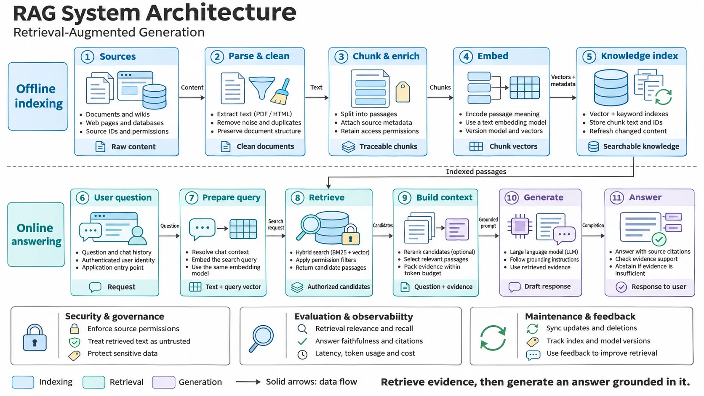
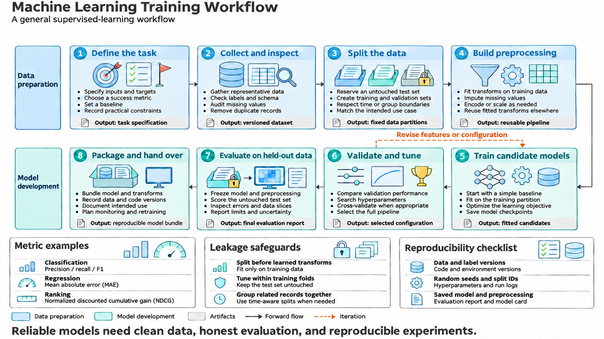
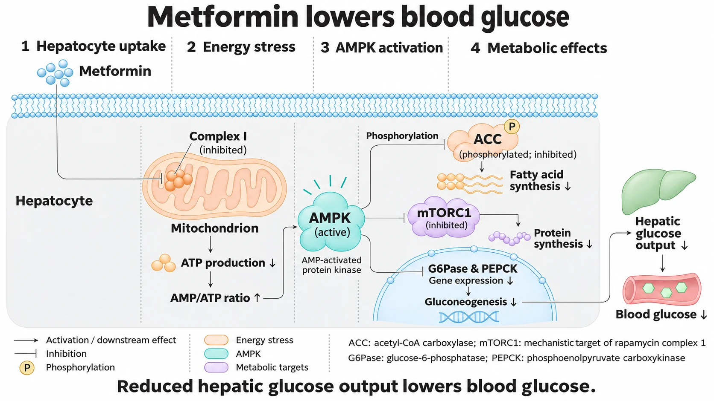
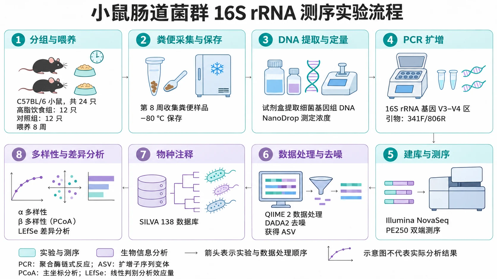

# scifig

English | [中文](README.zh-CN.md)

A skill pack that teaches AI coding agents to make publication-ready scientific figures. One command installs the `scifig` skill into Codex, Claude Code, Antigravity and the other agents it finds on your machine:

```sh
npx scifig-agents setup
```

Then ask your agent in plain words: "Draw a Transformer architecture figure for my group-meeting slides", "Make a graphical abstract", "Plot this CSV as a Nature single-column figure", "Export this figure as a 600 dpi TIFF", "Can this figure go to Cell?".

<table>
  <tr>
    <td width="50%"><br><b>RAG system architecture</b></td>
    <td width="50%"><br><b>Machine-learning training workflow</b></td>
  </tr>
  <tr>
    <td width="50%"><br><b>How metformin lowers blood glucose</b></td>
    <td width="50%"><br><b>16S rRNA sequencing workflow, in Chinese</b></td>
  </tr>
</table>

Each was made end to end by a fresh Codex session that had only this skill and a one-sentence request. The requests, and how each figure was made, are in the [gallery](https://lionelee.github.io/scifig/).

## What it does

| Capability | How |
|---|---|
| Concept and structure figures: graphical abstracts, mechanisms, pathways, workflows, research roadmaps, frameworks, model and system architectures; from text, from a sketch, or by editing an image | The agent writes a detailed brief and hands it to **its own image-generation tool** (Codex `image_gen`, Antigravity `generate_image`). The skill supplies:<br>• how to write the brief and lay out each figure type;<br>• a six-layer content plan: spine, details, annotations, inputs and outputs, reading aids, pictures;<br>• tested visual styles;<br>• a low-saturation palette with colour codes, and hairline weights;<br>• a step-by-step verification.<br>No image API, no API key. |
| Text check | `check_text.py` reads the figure with OCR and compares it with the list of labels; every mismatch is cut out, enlarged and read again. Verdicts:<br>• `DIFFERS`: both readings spell it the same wrong way, so the figure has a typo and must be fixed;<br>• `MISSING`: OCR cannot tell (numbers, symbols, Greek letters, sub- and superscripts, a doubled letter read as one), so a person looks;<br>• `COUNT`: a label appears in the wrong number of places;<br>• `EXTRA`: text nobody asked for.<br>It also measures the type size. |
| Enlarge to high resolution | `enlarge.py` cuts a generated figure along clear space into equal, overlapping tiles; the image tool redraws each tile as a sharper copy, and the tiles are aligned and joined into a figure 1.6–2× larger. The detail is redrawn, not interpolated. A tile that moved, changed or cannot be read is enlarged plainly instead, and the report says so. One generation per tile. |
| Figures that must be code: PRISMA and CONSORT flow diagrams whose counts must add up; formal notations such as circuits, plasmid maps and phylogenetic trees | The agent writes drawing code on a millimetre canvas with exact text and numbers, and outputs a vector PDF. Other structure figures take this route too when the agent has no image tool, the destination refuses AI-generated images, or you ask for vector artwork; they look plainer than generated ones. |
| Data charts | The agent writes matplotlib code; `scistyle.py` handles journal column widths, fonts and sizes, colour-blind-safe palettes and vector output. The chart guide covers 46 chart types. Your data never goes through an image model. |
| Submission files | `export_figure.py` exports TIFF, PNG or PDF at a journal's column width and dpi. |
| Multi-panel figures | `panels.py` lays raster panels out at a journal width and adds a, b, c labels (kept as text in a PDF). |
| Editable versions | `editable.py` finds the text by OCR, erases it from the picture and puts it back as editable text: PPTX, SVG with editable text, or SVG with the shapes traced as vectors too. |
| Pre-submission check | `check_figure.py` checks file format, effective dpi, transparency, colour mode, greyscale legibility and colour-blind safety, and writes greyscale and colour-blindness previews.<br>• When a figure has no strong colours to compare, the two colour checks say SKIP, not PASS.<br>• `--look` measures fill chroma and line weight.<br>• `--screen` judges a figure for slides or the web only. |
| Figure legends | The agent drafts them from the figure; a missing fact stays `[placeholder]` and is never guessed. |
| Journal rules and AI-image policies | Figure specifications of 10 publishers and AI-image policies of 9, each with its verification date. |

## Install

Needs Node.js 20.12 or later. The Python scripts need [uv](https://docs.astral.sh/uv/), which downloads their dependencies on first run, pinned to the day they were tested.

```sh
npx scifig-agents setup              # pick folders in a list, review, confirm
npx scifig-agents setup --dry-run    # show the plan only, write nothing
npx scifig-agents setup --client codex --client claude_code --yes
npx scifig-agents setup --dir ~/somewhere/skills --yes
npx scifig-agents doctor             # install state of each agent, image tools, uv
npx scifig-agents uninstall          # remove only what this tool installed
```

In a terminal, `setup` lists the ten skills folders that the supported agents read, with the folders of the agents it found already ticked. Move with the arrow keys, tick or untick with Space, and press Enter; it then shows what it will change and asks once more. `--accessible` asks about one folder at a time instead of showing the list. `--client` or `--dir` skips the list, and `--yes` skips the questions.

The same package is on GitHub Packages as `@lionelee/scifig-agents`. Without a registry, run it straight from GitHub with `npx github:lionelee/scifig setup`, or from a clone of this repository: run `npm install` once, then `node bin/scifig.mjs setup`.

### Supported agents

Detection matches [rea-agents](https://www.npmjs.com/package/rea-agents) 6.9.0: the same 29 agents, the same `--client` ids, and the same rule, under which an agent is present when its configuration file or its own folder exists. `doctor` lists the ones it finds on your machine.

| Where the skill goes | Agents (`--client` id) |
|---|---|
| The agent's own skills folder | Claude Code `claude_code` (`skills/` under `$CLAUDE_CONFIG_DIR` or `~/.claude`), CodeBuddy `codebuddy` (`~/.codebuddy/skills`), Antigravity `antigravity` (`~/.gemini/config/skills`), Trae `trae` (`~/.trae/skills`), WorkBuddy `workbuddy` (`~/.workbuddy/skills`), Hermes `hermes` (`~/.hermes/skills`, or under `$HERMES_HOME` and its active profile), Qoder `qoder` (`skills/` under `$QODER_CONFIG_DIR` or `~/.qoder`), Factory Droid `droid` (`~/.factory/skills`), ZCode `zcode` (`~/.zcode/skills`) |
| The shared `~/.agents/skills`, one copy for all of them | Codex `codex`, Claude Desktop `claude_desktop`, Cursor `cursor`, Cline CLI `cline`, Gemini CLI `gemini_cli`, Windsurf `windsurf`, Devin `devin`, OpenCode `opencode`, GitHub Copilot CLI `copilot_cli`, Command Code `commandcode`, Qwen Code `qwen_code`, Kimi Code `kimi`, VS Code `vscode`, LM Studio `lm_studio`, Grok Build `grok_build`, OMP `omp`, Pi `pi`, DeepSeek Harness `dsh`, FreeBuff `freebuff`, Grok Bot `grok_bot` |

With `GEMINI_CLI_HOME` or `DSH_AGENTS_HOME` set, Gemini CLI and DeepSeek Harness get `.agents/skills/` under those folders instead.

Finished generated figures need an agent with an image tool:

- **Codex**: built-in `image_gen`. The only one tested end to end.
- **Antigravity**: built-in `generate_image`. Checked against its documentation, not yet run.
- **Other agents**: no known built-in image tool. Charts, code-drawn diagrams, export, panels, editable versions, checks and legends all work; concept and structure figures are drawn in code and look plainer, unless you connect an image tool.

Whether an agent actually loads skills from these folders is up to the agent; the folders follow rea-agents.

How the installer behaves:

- Each install holds a `.scifig-install.json` with its version and a digest of its contents. A rerun leaves an identical install alone and replaces a different one as a whole.
- It refuses to touch a `scifig` folder that it did not install.
- Agents that read the same folder share one copy, and the plan names them all.
- Where it cannot ask you, it changes nothing unless you pass `--yes`.
- A half-made copy left by an interrupted setup is cleared by the next one.
- Start a new agent session to pick up the skill.

## Good to know

The measurements behind these notes are recorded in [CALIBRATION.md](CALIBRATION.md).

- **The look comes from the agent's own image tool.** It has been tested only with Codex `image_gen`: 191 figures in 63 end-to-end sessions. Antigravity has not been tested. An agent without an image tool (Claude Code, for one) draws figures in code, and they look plainer.
- **Connectors are where first drafts go wrong most.** About one full figure in five needs an edit for a line. The skill's line rules were written from those faults:
  - row and band names stand in a rail at the left end, not above;
  - connectors are numbered, with their total;
  - every line has one arrowhead;
  - lines do not cross where it can be avoided.
- **The text check is binding: its verdict is not overruled by a look at the figure.** Image tools now and then misspell. In early tests, two figures with a typo were handed over after an agent glanced at them and blamed OCR, so a `DIFFERS` must be fixed. Its limits:
  - OCR often reads a doubled letter as one; such places come back `MISSING`, with a hint to count the letters;
  - Greek letters, sub- and superscripts and symbols are only flagged for a person to look at;
  - after a word has been corrected, look at it enlarged.

  A word that two edits cannot fix is erased and set in code.
- **Calibrated on SciDraw's 79 public samples** by measurement, not by eye:
  - fills are faint tints, given as colour codes;
  - generic subjects are drawn as full as the fuller half of the samples;
  - outlines are about 2 px;
  - pictures are small solid illustrations of three or four objects.
- **The content comes from your material.** For your own research, every fact in the figure is one you stated. The agent may add what a method you named is, takes in and puts out; it lists such lines for you to confirm, adds them when nobody answers, and names each one in its hand-over so you can strike it. Numbers, names, results and choices specific to your study are never made up. Textbook subjects (a Transformer, a training pipeline) are drawn in full from general knowledge, with the source named.
- **Two kinds of graphical abstract.** One for a journal follows the journal's rules (few words, no data plots); a research overview for a poster, a talk or a web page is drawn as four or five scenes, each with a heading and a line or two.
- **A generated figure is an AI-generated image.** Architectures and roadmaps now come from the image tool too, so publishers' AI-image policies apply to them (Nature journals, for one, do not accept AI-generated schematics). The skill asks where a figure is going first, and draws it in code where AI images are not allowed.
- **Resolution is limited, and can be bought with generations.** Codex returns about 1.5 megapixels per image (1672 × 941 at 16:9) and takes no size argument. `enlarge.py` redraws a figure tile by tile with the same tool:
  - 4 tiles: about 1.6–2× larger, for 4 more generations;
  - 6 tiles: about 2.1× larger, for 6 more.

  When nobody can be asked, it enlarges only when the request itself asks for a large, sharp or high-resolution file. To spend no generations, `export_figure.py` interpolates, and says that this adds no real detail.
- **Landscape or portrait, by use.** Landscape has more pixels and finer lines, for slides and dense figures. Printed at a fixed width, portrait gives larger type, so a figure with a page to itself (as in a thesis) is portrait, with `enlarge.py` adding pixels.
- **The first runs of `editable.py` and `check_text.py` are slow.** Both use OCR: uv downloads about 100 MB of packages, OCR models included, about 600 MB unpacked in its cache. Later runs take seconds. The other scripts need only matplotlib, numpy and pillow.
- **Telemetry.** onnxruntime, which runs the OCR, reports usage to Microsoft in its official build and writes a device id into your home folder. `editable.py` sets `ORT_DISABLE_TELEMETRY=1` before loading it, `check_text.py` shares that code, and a test checks that nothing new appears in the home folder.
- **What OCR reads.** English and Chinese. Greek letters, sub- and superscripts, accented letters and symbols are often misread; Japanese kana, Korean and Cyrillic are not supported and never decide a verdict. Check converted labels one by one.
- **Chinese text** in charts and diagrams falls back to an installed Chinese font (Heiti SC on macOS) while Latin text keeps the journal font; both stay editable text in a PDF. For documents no journal typesets, such as a thesis or a grant proposal, set the size and fonts yourself: `scistyle.use("default", font_pt=10.5, fonts=["Times New Roman", "Songti SC"])`.
- **Journal data is dated.** The bundled figure specifications and AI-image policies were verified on 2026-07-21; check the journal's site before you submit.

## Layout

```
bin/scifig.mjs        installer entry point: setup, uninstall, doctor
lib/                  the agent table (aligned with rea-agents), the install logic and the terminal prompts
skills/scifig/
  SKILL.md            entry point: routes each request
  references/         illustration, figure recipes, diagrams, charts, export and checks, AI policies, journal data
  scripts/            journals, scistyle, export_figure, panels, check_figure, check_text, enlarge, editable
test/                 Node tests (installer, docs, packaging) and pytest tests (scripts)
eval/                 end-to-end runs with Codex, text-check regression, comparison with SciDraw's samples (not shipped)
docs/                 the GitHub Pages gallery
CALIBRATION.md        the measurements behind the rules
```

## Relationship to sci-draw.com

This project was inspired by the public feature set of SciDraw AI (sci-draw.com): three drawing modes, data charts, export and conversion, pre-submission checks. It is an independent implementation:

- It calls none of sci-draw.com's interfaces and contains none of its code or prompts.
- It bundles reference data that SciDraw published under CC BY 4.0 (journal figure specifications, publisher AI-image policies, a notation table); sources and dates are in [NOTICE.md](NOTICE.md).
- To use SciDraw's own service, use its official plugin `TopLocalAI/scidraw-plugins`.

## Contributing

See [CONTRIBUTING.md](CONTRIBUTING.md). To report a security issue, see [SECURITY.md](SECURITY.md).

## License

[MIT](LICENSE) © lionelee. Third-party material: [NOTICE.md](NOTICE.md).
